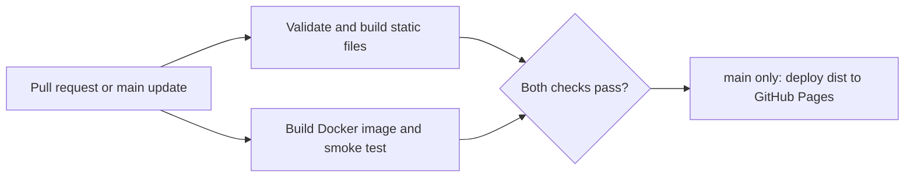

# Kamkhaya Construction

A responsive, static company and interior design portfolio with light/dark themes, project photography, and direct contact links. Built with HTML, CSS, and JavaScript. Includes a multi-stage Docker preview and GitHub Actions CI/CD; the public deployment target remains GitHub Pages.

The current version supports **local review and an intentional client demo**. The company email is explicitly a placeholder; replace it before a production deployment. The manual demo option described below allows the labelled preview email without disabling the site or container checks.

## Local preview

Requires Python 3.10 or newer:

```sh
python3 scripts/serve.py
```

Open **http://127.0.0.1:4173/**. Use `--port 8000` if that port is occupied. Stop the server with Ctrl+C. It listens only on this computer.

## Check and build

```sh
python3 scripts/check.py
python3 scripts/build.py
python3 scripts/check.py --root dist
```

`dist/` contains only the public site and is ignored by Git. The build never includes `.git`, the source archive, local tools, documentation, or `.local/`. The checker verifies HTML section links and asset paths, image alt attributes, and project-subpath compatibility. If Node is available it also checks JavaScript syntax; local Python checks do not replace browser interaction testing.

Preview the actual deployment output:

```sh
python3 scripts/serve.py --directory dist
```

Check publication readiness:

```sh
python3 scripts/check.py --strict-contact
```

The normal check allows an unfinished contact configuration for local review and prints a warning. The strict check requires the company name, phone, and a real email. It rejects `emailIsPlaceholder: true` and reserved example domains. Production runs always use the strict check. Only a manual run with `demo_mode` explicitly enabled skips that production-only check; all normal validation and Docker smoke tests still apply.

## Edit content

- **Company and contact details:** `assets/js/company.js`. The confirmed phone is `+91 79057 38618`; WhatsApp uses `917905738618`. Replace the placeholder email and set `emailIsPlaceholder: false` together.
- **Page copy and layout:** `index.html` and files in `assets/css/`.
- **Interactive behavior:** `assets/js/main.js`; gallery titles, categories, and descriptions live with each project card in `index.html`.
- **Portfolio media:** `assets/images/` and `assets/video/`; retain descriptive alt text when changing photographs.

Each `.project-card` needs a matching `data-category` and a `data-description` for its dialog. Category counts update automatically; photographs appear six at a time, while dialog navigation covers the full selected category. Walkthroughs use collapsed `<details>` with native video controls, `preload="none"`, an optimized MP4, a poster image, and a visible description. Retain installation/in-progress wording where the media shows unfinished work.

Keep local asset paths relative, such as `assets/images/project.jpg`. Leading `/assets/` paths break on GitHub project Pages. Do not add credentials or private client documents to this repository. Original WhatsApp media is kept out of the public build; use optimized portfolio assets.

The enquiry form prepares a message for the visitor to review, then opens WhatsApp only when they choose to continue. The visitor decides when to send it; the website does not submit or store their details. The dummy company email is labelled and is not clickable. Replacing it with a real address enables a normal email link. A hosted enquiry inbox or form provider would be a separate integration.

## GitHub Pages deployment — after approval

The workflow is prepared in `.github/workflows/pages.yml`. Running the local commands above does not deploy anything.

1. Finish local review. For production, replace the dummy email; for a client demo, keep its visible preview label and select the manual demo option in step 4.
2. Push the agreed workflow changes to `main` using your chosen commands.
3. On GitHub, go to **Settings → Pages → Build and deployment → Source**, then select **GitHub Actions**. GitHub may create the `github-pages` environment automatically; restrict its deployment branches to `main` in the repository environment settings.
4. After enabling Pages, open **Actions → Validate and deploy GitHub Pages → Run workflow**, selecting `main`. For a client demo, check **Publish a client demo with the labelled preview email** (`demo_mode`). Leave it unchecked for production; its default is `false`. This also handles an initial push that ran before Pages was configured. The workflow validates and builds the site, runs the Docker smoke test, packages only `dist/`, and deploys. Pushes to `main` always require real contact details, even after a demo. Pull requests validate/build without publishing; manual runs deploy only when `main` is selected.
5. Open the deployment URL reported by the Actions run. For this repository it is expected to be `https://prakharshukla25.github.io/Kamakhya-Construction/`, subject to repository and Pages settings.

The demo and production use the same public GitHub Pages URL. Demo mode does not create a private preview or change the displayed email; it permits the existing clearly labelled placeholder for a manually requested client review. To publish the finished version, replace the email and clear `emailIsPlaceholder`, then push `main` or run the workflow with `demo_mode` unchecked.

The workflow uses official GitHub Actions pinned to immutable release SHAs, separate build/container/deploy jobs, limited token permissions, deployment concurrency, and short artifact retention. Every PR and main-branch run checks the static site and builds/smoke-tests the Docker image. Deployment requires both jobs to pass. The deployment job uses GitHub's OIDC token; no personal access token or cloud secret is required. No Docker image is pushed to a registry. Update action pins intentionally when maintaining the repository.



For rollback, restore an earlier approved source revision on `main` and run the same workflow. A custom domain is optional; add its DNS records and a `CNAME` file only after choosing the domain. Enable HTTPS in Pages settings once GitHub has issued the certificate.

GitHub Pages supports public repositories on GitHub Free; private repositories require an eligible paid plan. This site is an informational portfolio. GitHub restricts Pages use for sites primarily facilitating commercial transactions; adding payments, ecommerce, or SaaS requires revisiting the hosting choice. No checkout or payment handling is included here.

## Docker preview

Docker provides a reproducible NGINX preview and a portable container option. **GitHub Pages serves the generated static files; it does not run Docker containers.** Python preview remains available without Docker.

Requires Docker Engine or Docker Desktop with Docker Compose:

```sh
docker compose up --build --detach
```

Open **http://127.0.0.1:8080/**. Useful checks and cleanup:

```sh
docker compose ps
docker compose logs web
curl --fail http://127.0.0.1:8080/healthz
docker compose down
```

For a standalone image build, use `docker build --tag kamkhaya-construction:local .`. The Dockerfile runs the dependency-free Python validator/build in its first stage and copies only `dist/` into the final NGINX image. Docker builds allow the clearly marked dummy email for preview; production Pages runs still require a real email, while a manual `demo_mode` run permits the labelled placeholder.

Both base images are pinned to public registry digests verified on 15 November 2026. The runtime inherits NGINX's unprivileged user (UID 101), listens on 8080, bypasses configuration-rewriting entrypoint scripts, and writes its PID/temporary files only under `/tmp`. Compose uses a read-only filesystem, `/tmp` tmpfs, no Linux capabilities, and no privilege escalation. Health checks use `/healthz`; HTML revalidates and unhashed assets cache for one hour. These headers apply to the container, while GitHub controls the headers on GitHub Pages.

Docker is not installed locally. The Docker image build and read-only container smoke test passed in [GitHub Actions run 44853999782](https://github.com/prakharshukla25/Kamakhya-Construction/actions/runs/44853999782). That run stopped at the production check for the dummy email; the manual demo option handles this intentional preview state. The smoke test validates Compose, requests the homepage/health endpoint/config asset, checks the runtime user, and confirms private Git paths return 404.

Optional Make shortcuts: `make preview`, `make check`, `make ready`, `make build`, `make preview-dist`, `make docker-build`, `make docker-up`, and `make docker-down`.

## References

Deployment and billing documentation checked on 15 November 2026:

- [GitHub: custom Pages workflows](https://docs.github.com/en/pages/getting-started-with-github-pages/using-custom-workflows-with-github-pages)
- [GitHub: configuring a Pages publishing source](https://docs.github.com/en/pages/getting-started-with-github-pages/configuring-a-publishing-source-for-your-github-pages-site)
- [GitHub: manual workflow inputs and boolean types](https://docs.github.com/en/actions/reference/workflows-and-actions/workflow-syntax#onworkflow_dispatchinputs)
- [GitHub: Pages eligibility and project URLs](https://docs.github.com/en/pages/getting-started-with-github-pages/what-is-github-pages)
- [GitHub: Pages usage limits](https://docs.github.com/en/pages/getting-started-with-github-pages/github-pages-limits)
- [GitHub: Actions billing](https://docs.github.com/en/billing/concepts/product-billing/github-actions)
- [Docker: multi-stage builds](https://docs.docker.com/build/building/multi-stage/)
- [Docker: pinning image digests](https://docs.docker.com/build/building/best-practices/#pin-base-image-versions)
- [NGINX: official unprivileged image source](https://github.com/nginx/docker-nginx-unprivileged)
- [Docker: Compose service configuration](https://docs.docker.com/reference/compose-file/services/)

See [ESTIMATE.md](ESTIMATE.md) for the proposed project quote and operating-cost assumptions.
